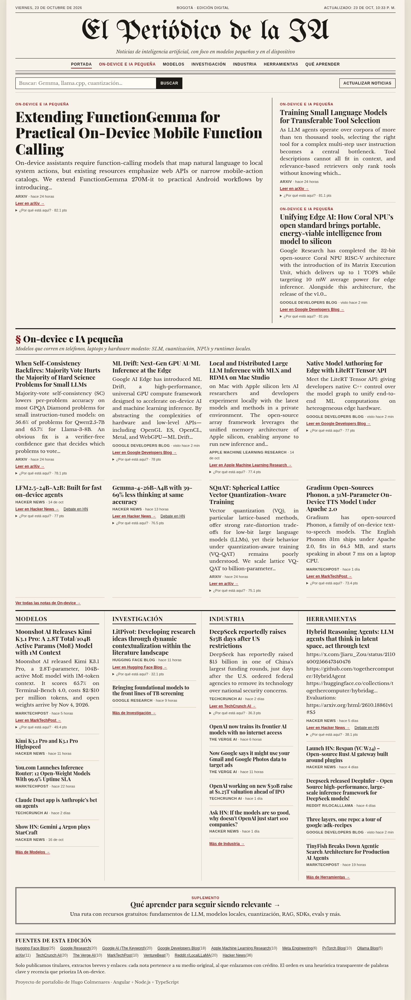
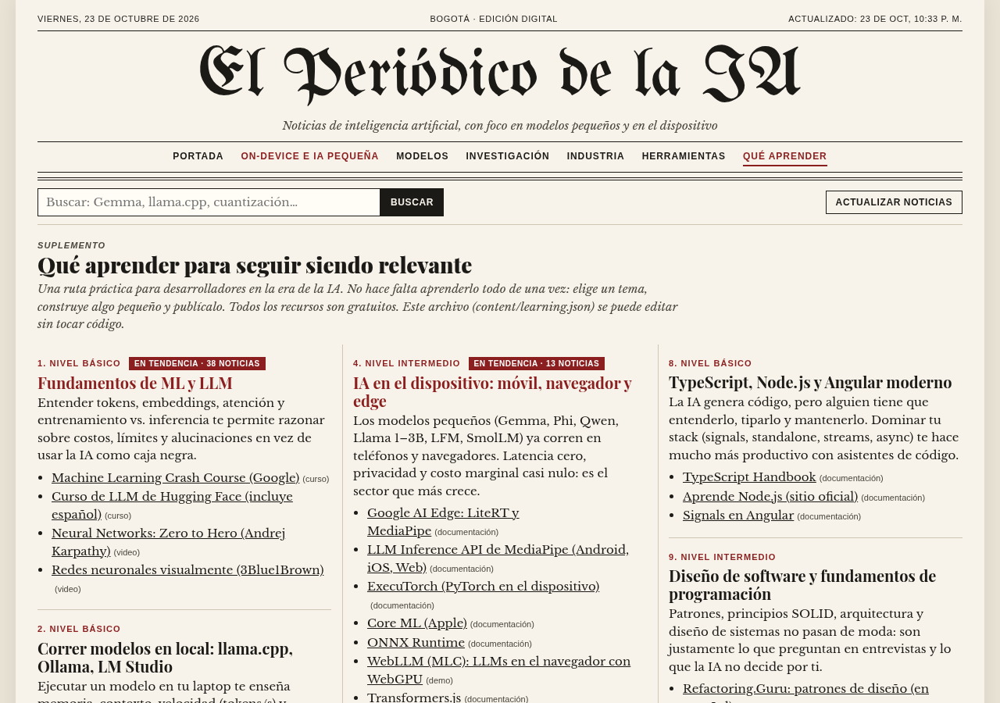

# El Periódico de la IA

Periódico digital que reúne las noticias más importantes de inteligencia artificial, con **foco en IA on-device e IA pequeña**: modelos de lenguaje pequeños (SLM), edge AI y modelos que corren en teléfonos y hardware modesto (Gemma, Phi, Llama/Qwen pequeños, LFM, SmolLM, MLC/WebLLM, llama.cpp, Ollama, ONNX Runtime, Core ML, MediaPipe/LiteRT, ExecuTorch, MLX, cuantización y NPUs).

Incluye además el suplemento **“Qué aprender para seguir siendo relevante”**, una ruta de aprendizaje editable con recursos gratuitos que marca qué temas están “en tendencia” según las noticias del día.

> Proyecto de portafolio de **Hugo Colmenares** — Angular + Node.js + TypeScript.

| Escritorio (1280 px) | Móvil (390 px) |
| --- | --- |
|  |  |



## Qué hace

- **Recolecta** noticias al arrancar, cada 30 minutos y bajo demanda (botón “Actualizar noticias” o `POST /api/refresh`) desde fuentes gratuitas y **sin API keys**: feeds RSS/Atom (Hugging Face, Google Research, Google AI, Google Developers, Apple ML Research, Meta Engineering, PyTorch, Ollama, arXiv, TechCrunch AI, The Verge AI, MarkTechPost, VentureBeat), Hacker News vía la API de Algolia y r/LocalLLaMA.
- **Normaliza** cada nota (título, fuente, URL, fecha, extracto corto, imagen si existe), **deduplica** por URL canónica y por similitud de títulos, y **ordena** con una heurística transparente que favorece lo on-device.
- **Respeta a los medios**: nunca copia el texto completo; muestra solo titular, un extracto de máx. 280 caracteres, el crédito a la fuente y el enlace al original.
- **Tolerante a fallos**: si una fuente cae se omite; si fallan todas, sirve la última caché; si no hay caché, usa un dataset de muestra incluido y lo **indica claramente** en la portada.

## Arquitectura

```
periodico-ia/
├── server/                  # API Node.js + TypeScript (Fastify)
│   ├── src/
│   │   ├── sources.config.ts   # ← todas las fuentes en un solo archivo
│   │   ├── fetchers.ts         # RSS/Atom (rss-parser) y Hacker News (Algolia)
│   │   ├── normalize.ts        # limpieza de HTML, extractos, URL canónica, fechas
│   │   ├── dedup.ts            # deduplicación por URL y similitud de Jaccard
│   │   ├── ranking.ts          # palabras clave + recencia + popularidad
│   │   ├── aggregator.ts       # orquesta, aplica fallback y guarda caché
│   │   ├── cache.ts            # caché JSON con escritura atómica
│   │   ├── learning.ts         # ruta de aprendizaje + temas en tendencia
│   │   ├── app.ts / index.ts   # rutas REST, estáticos en producción, programación
│   │   └── check-*.ts          # verificadores de fuentes y enlaces
│   ├── data/sample-news.json   # dataset de muestra (marcado como muestra)
│   └── test/                   # Vitest: normalización, dedup, ranking, API, fallback
├── web/                     # Angular 22 (standalone components + signals, sin zone.js)
│   └── src/app/
│       ├── news.service.ts     # estado con signals + HttpClient
│       └── components/         # masthead, front-page, article-card, learning-section
├── content/learning.json    # ← ruta “Qué aprender” (editable sin tocar código)
├── scripts/screenshots.mjs  # capturas con Playwright
└── .github/workflows/ci.yml # lint, tests y build
```

Flujo: `fuentes → fetchers → normalize → filtro de relevancia → dedup → ranking → caché JSON → API REST → Angular`.

### API REST

| Método y ruta | Descripción |
| --- | --- |
| `GET /api/news?section=&source=&q=&page=&pageSize=` | Noticias ordenadas. `section`: `on-device`, `modelos`, `investigacion`, `industria`, `herramientas`. Responde además `mode` (`live`, `cache` o `sample`) y `fetchedAt`. |
| `GET /api/sources` | Estado de cada fuente en la última actualización (ok, cantidad, error). |
| `GET /api/learning` | Ruta de aprendizaje con menciones en noticias y bandera `trending`. |
| `POST /api/refresh` | Fuerza una actualización (las peticiones simultáneas comparten la misma descarga). |

### Ranking transparente

```
score = topic + onDevice + recency + popularity
```

- **topic** (máx. 40): suma de pesos de palabras clave por sección; las coincidencias en el título valen el doble.
- **onDevice**: si el puntaje on-device supera el umbral (10), suma **30 + ese puntaje** (máx. 30). Es el empujón editorial del periódico.
- **recency** (0–30): decae a la mitad cada 36 horas. Si el feed no publica fecha, se usa la fecha en que vimos la nota y la recencia se limita a 10.
- **popularity** (0–10): logaritmo de los puntos de Hacker News.

Cada nota expone `scoreBreakdown` y `matchedKeywords`; en la interfaz se ven en “¿Por qué está aquí?”. La portada además limita cuántas notas de una misma fuente aparecen en cada bloque, para que no la domine un solo medio. Las palabras clave están en `server/src/ranking.ts`.

## Cómo ejecutarlo

Requisitos: **Node.js 22.22+ o 24** (Angular 22 lo exige) y npm 10+.

```bash
npm install
npm run dev        # API en http://localhost:3000 + Angular en http://localhost:4200 (con proxy a /api)
```

Producción (el servidor Node sirve la app Angular compilada):

```bash
npm run build
npm start          # http://localhost:3000
```

Variables opcionales: `PORT` (3000), `REFRESH_MINUTES` (30), `CACHE_FILE`, `LEARNING_FILE`.

Otros comandos:

```bash
npm test                         # tests del servidor (Vitest) y del frontend (ng test + Vitest)
npm run lint                     # ESLint + typecheck
npm run check:sources            # verifica cada fuente y cuántas notas aporta
npm run check:links -w server    # verifica los enlaces de content/learning.json
npm run screenshots              # capturas en docs/screenshots (con el servidor corriendo)
docker build -t periodico-ia . && docker run -p 3000:3000 periodico-ia
```

## Cómo agregar una fuente

1. Abre `server/src/sources.config.ts` y añade un objeto:

   ```ts
   {
     id: 'mi-fuente',                 // se usa en /api/news?source=mi-fuente
     name: 'Mi Fuente',
     type: 'rss',                     // 'rss' (RSS o Atom) o 'hn'
     url: 'https://ejemplo.com/feed.xml',
     homepage: 'https://ejemplo.com',
     defaultSection: 'herramientas',  // sección si la heurística no decide
     requireKeywords: true,           // true: solo notas de IA · 'on-device': solo on-device
     maxItems: 20,
     enabled: true,
   }
   ```

2. Ejecuta `npm run check:sources` para comprobar que responde.
3. Reinicia el servidor o pulsa “Actualizar noticias”.

Para Hacker News, las búsquedas están en `HN_QUERIES` del mismo archivo.

### Estado de las fuentes (verificado el 23 de octubre de 2026)

Activas y respondiendo: Hugging Face, Google Research, Google AI (The Keyword), Google Developers, Apple ML Research, Meta Engineering, PyTorch, Ollama, arXiv (RSS de cs.LG + cs.CL + cs.AR filtrado a temas on-device), TechCrunch AI, The Verge AI, MarkTechPost, VentureBeat (vía FeedBurner), r/LocalLLaMA y Hacker News.

Descartadas o sustituidas:

- **Meta AI** (`ai.meta.com/blog`): no tiene RSS (404). Se usa `engineering.fb.com/feed` filtrado por términos de IA.
- **arXiv API** (`export.arxiv.org`): no respondió (timeout). Queda en la configuración con `enabled: false`; se usa `rss.arxiv.org`.
- **VentureBeat** (`venturebeat.com/category/ai/feed`): responde 429; se usa su feed de FeedBurner, que puede venir desactualizado.
- **Reddit**: limita peticiones anónimas (429 intermitente). Si falla se omite sin afectar al resto.

## Editar “Qué aprender”

Todo está en `content/learning.json`: temas, nivel, por qué importa, palabras clave (para detectar tendencias en las noticias) y recursos gratuitos. Los cambios se ven al recargar la página, sin recompilar. Verifica los enlaces con `npm run check:links -w server`.

## Tests

- **Servidor** (Vitest): normalización (HTML, extractos, URL canónicas, fechas), deduplicación, detección on-device, clasificación por sección, puntaje y su desglose, pipeline, API REST y fallback.
- **Frontend** (Vitest vía `ng test`): `ArticleCard` (enlace al original, crédito, variantes), `FrontPage` (nota principal on-device, diversidad por fuente, secciones) y `Masthead` (aviso de datos de muestra y navegación).

## Licencia

MIT. Los titulares y extractos pertenecen a sus respectivos medios; esta app solo enlaza al contenido original.
